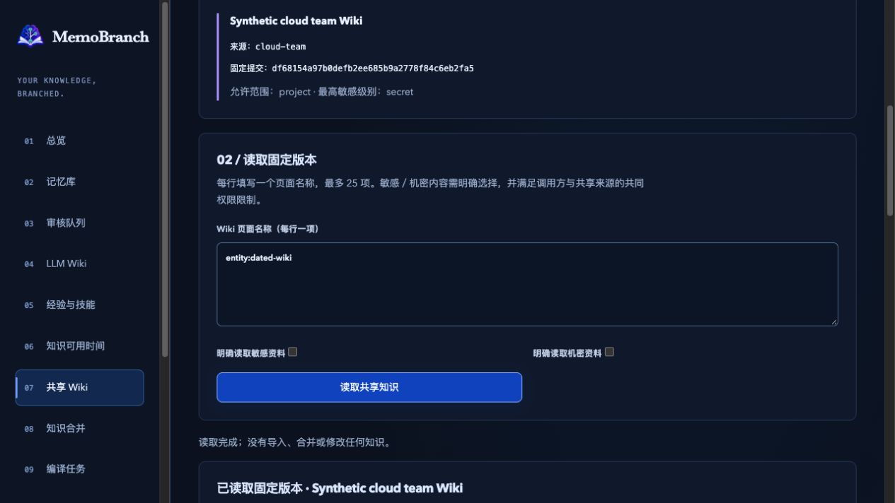
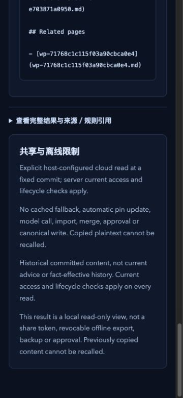

# Cloud Wiki client candidate — 2026-10-26

Repository: `sens-io/memobranch`. Source branch: `kevin/knowledge-expansion`.
Core candidate `fcff39a43946ca939c8117b4640ad2a363f8d9b8`; UI wording correction
`673d83c5`; legacy-condition fix `10137d91`; legacy-date fix `5d3365e5`.
Installed-check candidate `db41e876`.

## Scope

This checkpoint adds strict version 2 local/cloud host bindings, a bounded HTTPS
client, complete received-graph checks and retained expiry/configuration guards.
Existing CLI, MCP, Harness and local Web sharing reads dispatch through the
configured transport. Cloud credentials stay on the host. The library importer
performs a fresh remote read before a separately confirmed derived-source copy;
no automatic Wiki write occurs.

The user also selected Git remote sharing. That transport, service setup commands,
whole-batch cloud acceptance and the other remaining roadmap batches are not
complete. No real account, grant, service, deployment, push or npm publication was
created. See [instructions](cloud-sharing.md) and [roadmap](remaining-roadmap.md).

## Retained checks

| Check | Result |
| --- | --- |
| Build and test type checking | Passed with the legacy-date fix. |
| Related core and adapter checks | 73/73, zero failures/skips/cancellations; `.scratch/cloud-shared-wiki-client-targeted-5.log`. |
| Separate existing/new CLI, MCP, Harness and Web read checks | 18/18; includes 4 new cloud adapter tests, not 18 new cloud tests. `.scratch/cloud-shared-wiki-client-adapters-2.log`. |
| Minimum Node 20.0.0 compiled-JavaScript tests | Final legacy-date candidate passed all 34 client/service checks (17 client + 17 service), zero skipped/cancelled. |
| Full retained checks, both Git defaults | Each passed 938 checks: 914 functional + 14 release-script + 10 evaluation checks, zero failures/skips/cancellations. |
| Strict OpenSpec / production audit | Final strict validation 31/31; production audit zero vulnerabilities. |
| Same installed artifact, Node 20/22 | Both passed with one unchanged 436-entry tarball; installed-check code review is complete. |
| Native browser | Completed on the synthetic runtime described below; source/broker/client state unchanged. |
| Independent fixed-candidate review | Every implementation file reviewed; both confirmed legacy compatibility defects fixed and independently closed. Final checkpoint `a44af3a3`: 5/5 files reviewed, zero skipped, no confirmed issue. |

Core tests cover real HTTP/HTTPS, trust of a locally generated CA, rejected
untrusted certificates, changed CA/binding/credential, current account/source
revocation, private attenuation before decryption, source key erasure, strict
identity/pin/graph/metadata bounds, malformed bytes, redirects with no credential
forwarding, and actual source-lock cancellation. A fake endpoint is used only for
malformed protocol and conservative-lease cases; the real client remains in use.
An expiring remote lease during an actual destination writer wait refuses and
rolls the copy back. Secret remote text becomes encrypted derived evidence;
ordinary reads/preparation do not change canonical knowledge or run a model.

Full logs: `.scratch/cloud-shared-wiki-client-full-main.log` and `-full-master.log`;
minimum runtime: `.scratch/cloud-shared-wiki-client-node20-final.log`; final specs
and audit: `.scratch/cloud-shared-wiki-client-final-specs.log` and `-audit.json`.
These are local macOS checks, not a claim about remote GitHub CI. Runtime/test
sources did not change after `5d3365e5` during final verification.

## Installed and older-runtime compatibility checks

The exact archive was
`.scratch/cloud-client-package.1dRZPc/memobranch-1.1.0.tgz`, SHA-256
`ea325ba93a3e654635125fa7ae3d77bc8567fb5065f99225af28dbfe5ca82b12`.
It contains 436 entries and was packed once from `736bd420`, including the draft
checkpoint report. This final report text was updated afterward; runtime sources
are the reviewed `5d3365e5` code. Node 22.17.0/default `main` and Node 20.0.0/default
`master` independently installed the same file and passed all package checks.
Before/after archive hashes matched. Logs: `.scratch/cloud-shared-wiki-client-package-node22.log`
and `-package-node20.log`.

The installed cloud check uses public exports, real service HTTP and version 2
bindings. Read and preparation checks compare source/broker/client HEADs, refs,
indexes, model-call count and one named raw evidence file in each vault. Confirmed
copy creates derived evidence, leaves the Wiki empty and source/broker state
unchanged; exact retry makes no commit. A later source withdrawal refuses another
copy. These are three raw samples, not an all-files integrity scan.

An additional actual older archive
(`.scratch/shared-wiki-package.BeISu0/memobranch-1.1.0.tgz`, SHA-256
`f71ae58885aa6b3c8c8fa82a520f5aca12c0ba501ecd5232608584a5a9fe5e90`)
was extracted and its compiled modules loaded on Node 22.17.0. Its reader refused
the new version 2 binding with `CONFIG_INVALID`; its vault refused the actual
copied digest-version-4 evidence with `VALIDATION_FAILED`. All three vault HEADs,
refs and indexes stayed unchanged. This uses the workspace dependency tree, not
an independent old-package installation or every historical reader/runtime.
Evidence: `.scratch/cloud-shared-wiki-client-compat.log` and
`.scratch/cloud-client-compat-observations.json`.

## Actual browser observations

The final browser fixture used the condition-fix runtime (`10137d91`, including
`673d83c5` UI wording) before the later legacy-date-only decoder correction.
Its selected pages are strict Wiki pages without legacy dates; the changed date
branches are covered by subsequent real API and Node tests. No browser claim is
made about an imported legacy date or cloud-account editor.

An actual local management session read a separate synthetic service with its
credential in the host environment. Catalog-only entry made zero snapshot calls.
The page showed the exact old body, source identity/full pin and version 1 while
the source was already at version 2. Expanded references contained the expected
evidence hash and built-in rule ID, with no credential field. Editing and leaving
the page cleared old content; logout returned to the login screen with no old body.

The source writer was genuinely held. A first read reached the existing source
lock timeout and showed a safe error without fallback or retry. A subsequent
read was cancelled while the real source queue contained 2 entries; it returned
to 1 entry and the page cleared old content. After releasing the writer, a fresh
read succeeded. Counts: 4 requests, 2 completed, 1 cancelled, 1 timed-out error.
These expected refusals are included rather than hidden as successful reads.

Before/after comparison matched all three fixture vault HEADs, refs, index hashes
and clean status, one named source raw-evidence hash, and model-call count 3.
It does not establish hashes of every raw file. Saved evidence:
`.scratch/cloud-client-native-observations.json` and
`.scratch/cloud-client-native-ui.json`.

Desktop document width/scroll width were both 1265, height 720; screenshot is
1265×712. A temporary 375×812 viewport produced document width/scroll width 360,
height 812 and a 360×780 screenshot: no document horizontal overflow. The viewport
was reset and the owned tab closed. The final fixture released its writer and
stopped normally. An earlier fixture with a closed control pipe was terminated
and replaced; its incomplete observations are not acceptance evidence. A failed
DOM role lookup for the references disclosure was corrected using its observed
native accessibility element. The navigation DOM selector did not match the
input, so that null value is not treated as proof of input clearing; the empty
input was observed in the native accessibility state instead.

## Findings and review

| Source branch | Finding | Correction and evidence |
| --- | --- | --- |
| `kevin/knowledge-expansion` | `fcff39a4`: ordinary memory allows empty conditions, but the cloud decoder rejected its support. | `10137d91`: preserve empty strings. Actual propose/approve/local/cloud page comparison and independent reproduction passed. |
| `kevin/knowledge-expansion` | `fcff39a4`: ordinary memory permits a finite date such as `2099-12-31`, but the decoder required full ISO date-time. | `5d3365e5`: preserve legacy Date.parse-compatible metadata/support dates; keep new Wiki and fact intervals strict. Full page comparison and independent real-service reproduction passed. |
| `kevin/knowledge-expansion` | Actual page still described only local/Git sources. | `673d83c5`: two wording changes include cloud sources, with no permission/style change; independent review and actual rendering checked. |

Review coverage: `fcff39a4` 4 core + 7 delivery files, `673d83c5` 2/2,
`10137d91` 2/2, `5d3365e5` 2/2, `db41e876` 2/2 and native checkpoint `736bd420`
3/3, final checkpoint `a44af3a3` 5/5; zero skipped. OCR provided
deterministic file/rule selection only, retaining its existing older-Git warning;
no external review model was used.

Initial authoring runs exposed an incorrect evidence filename assumption, a
duplicate-key error classification mismatch, an oversized test regular-expression
pattern and Harness test-type omissions. The filename check now preserves the
actual timestamp-prefixed evidence name; config errors remain config errors; the
long-body assertion compares the full literal substring; SDK fixture types use
their existing required options. Original assertions were retained. Failed runs
are not counted as passing checks.

## Change report

- Database changes: none.
- Data migration: none; no canonical record/schema is rewritten.
- Configuration: opt-in version 2 host bindings, credential environment selection,
  optional bounded CA file and timeout. Version 1 local files retain their behavior.
  No real host configuration changed.
- Push/publication/deployment: none; local commits only.
- Next: Git transport and setup, original import integration/adapters, optional
  bounded OCR and remaining full-roadmap acceptance. This checkpoint is partial.
