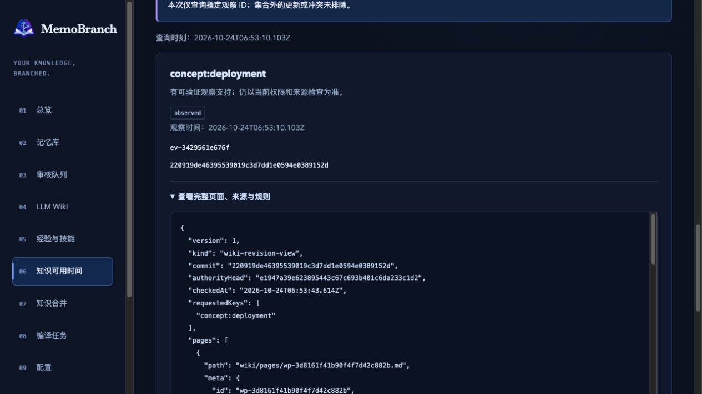
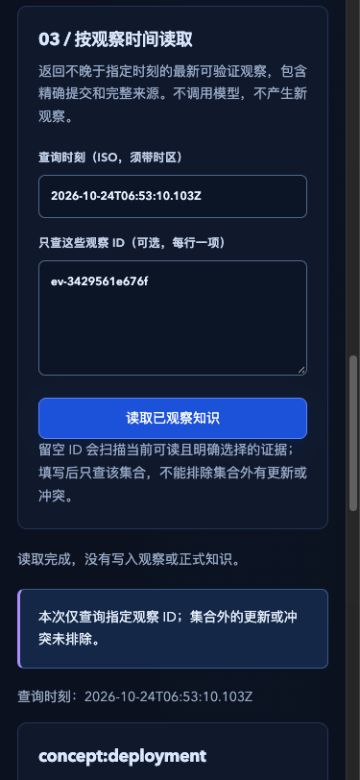

# Availability adapters — verification, 2026-10-24

Repository: `sens-io/memobranch`. Source branch: `kevin/knowledge-expansion`.
CLI/agent candidate: `24faf2b3878cf12952bbce3b3ddc7e6ae2af0a94`.
CLI confirmation fix: `71e568d3f93d19f0adca979398e674a81d1b0c4d`.
Web candidate: `fd6eba9a43411b27fd7ff5b3f6597c4b008ec97e`.
The library core was accepted separately; this record covers its CLI, MCP,
DeepSeek Harness and authenticated local Web adapters. Runtime, retained, installed,
native-browser and fixed-candidate review checks passed locally. Independent review
of checkpoint `224f13e` also passed: 9/9 files, skipped 0, no confirmed omission.
This acknowledgement changes no runtime. The overall roadmap remains open.

Adapters reuse the signed immutable observation and historical reconstruction
methods. Observation requires current read/write access and explicit confirmation;
reading never automatically observes, approves or calls a model. Host time and
local proof keys supply partial operational evidence, not first learning or a
model's thought history. Unknown legacy/conflicting observations remain unknown.
Current tenant, classification, private opt-in, source keys, withdrawal and expiry
still apply. Explicit observation IDs restrict coverage and cannot rule out outside
newer/conflicting records. Complete results fail at protocol limits rather than
silently truncate: 9 MiB escaped agent output, 16 MiB Web JSON envelope.

## Findings and corrections

| Source branch | Finding | Correction / independent recheck |
| --- | --- | --- |
| `kevin/knowledge-expansion` | P2: `--confirm=true=garbage` and private flags were cut at a second equals sign and accepted | `71e568d` retains all characters after the first equals sign; real CLI rejects all three malformed boolean flags and retains normal `CLI=v1=fixture`; independent fixed-source recheck passed |
| `kevin/knowledge-expansion` | Low: cancellation scenario promised no save without distinguishing commit settlement | `71e568d` limits the no-save guarantee to before the ready-to-commit decision and records completed-save identifiers; independent text recheck passed |
| `kevin/knowledge-expansion` | Low: the Web permission message said every identity lacking read/write could still query | `d88cf73` distinguishes recording's read/write requirement from querying's read requirement; independent fixed-text review passed |

The text follow-up also names source/rule references accurately: historical views
contain full page bodies, source IDs/paths/hashes and rule IDs/revisions, not raw
source bodies or rule instructions. It changes no request, state or permission
logic. Full checks below ran on `fd6eba9`; targeted Web checks repeat after the
text adjustment. Do not attribute a later wording change to the earlier full run.

## Executing checks

| Check | Actual result / evidence |
| --- | --- |
| Build and test types | Passed on Node 22.17.0 |
| CLI/real MCP/Harness and retained adapter tests | 35/35, failure/cancellation/skip 0; `.scratch/availability-adapters-targeted-4.log` |
| Additional ordinary CLI inline-value regression | 1/1; `.scratch/availability-cli-inline.log` |
| HTTP, UI-handler and retained Web checks | 93/93, failure/cancellation/skip 0; `.scratch/web-availability-targeted-1.log` |
| Targeted Web repeat after wording correction | Same 93/93, failure/cancellation/skip 0; `.scratch/web-availability-targeted-final.log` |
| Full Node 22 / Git main | 822 functional + 14 release + 10 evaluation = 846 passed, failure/cancellation/skip 0; `.scratch/availability-adapters-full-main.log` |
| Full Node 22 / Git master | Same 846 passed, failure/cancellation/skip 0; `.scratch/availability-adapters-full-master.log` |
| Strict cached OpenSpec 1.0.2 | 28 passed, 0 failed; `.scratch/web-availability-specs.log` |
| Production dependency audit | 0 known vulnerabilities; `.scratch/availability-adapters-audit.json` |
| Same installed artifact on Node 22.17.0/main and exact minimum Node 20.0.0/master | Both passed, same 387-entry package; `.scratch/availability-adapters-package-node22.log`, `-node20.log`; before/after SHA-256 records compare equal |
| Fixed-candidate independent review | CLI/agent 12/12, parser fix 4/4, Web 12/12, text correction 3/3 and checkpoint `224f13e` 9/9; no skipped file and no confirmed open finding |

Installed artifact: `.scratch/availability-adapters-package.qOfo1r/memobranch-1.1.0.tgz`.
SHA-256: `c4212d32f0ba1a8bd913c51b723731f1c87c262aa440a84a252477ece502db09`.
It includes `d88cf73` runtime text and the earlier pending version of this record;
these later completed-check rows do not change its runtime. Real installed
consumers execute the library, CLI, MCP, Harness and Web routes, historical version
change, strict refusal, current withdrawal and unchanged source/read state.
Installed cancellation checks remain pre-aborted-signal checks; real mid-wait
evidence is in the source/HTTP/SDK/native checks described separately.
Exact Node 20.0.0 logs the existing npm 11 CLI support warning, then successfully
executes the actual installed runtime/type programs. This does not claim hosted
CI, deployment or universal model effectiveness.

Real SDK tests cover explicit confirmation, unknown fields/identity/time overrides,
actual old/current page differences, private selection and current withdrawal,
foreign tenants, read/write grants and actual lock-wait cancellation. The CLI
SIGTERM test waits for its real queued operation, then checks cancellation and no
new observation. HTTP tests verify opt-out before decrypt, erased selected keys,
authenticated origin, cancellation isolation and sanitized completed-record errors.
The HTTP output/error adapter limits additionally use controlled method substitutes;
those substitutes do not prove a real core commit race.

UI-handler tests run the shipped script with a small DOM and fake HTTP responses.
They cover separate cancel-first confirmation, literal untrusted text, unknown
results, selection invalidation, cancelled/old responses, read-only controls and
navigation/disconnect cleanup. Independent reviewers also replayed confirmation
edits, stopped old saves followed by new reads, logout and duplicate submissions.
Their substitutes are not native rendering or actual server/network tests.

Initial Harness literal-type authoring errors were corrected before passing the
tests. A 34/35 run exposed the old exact MCP tool list missing the newly registered
observation tool; it was updated with the exact name and both tools' truthful
read/write hints, without loosening assertions. Logs are retained. Local OCR only
selects files/resolves rules; its older-Git warning remains, and no external review
endpoint, Git upgrade, assertion/concurrency/budget reduction was used.

## Actual browser evidence

The native in-app browser used a fresh synthetic vault
`.scratch/web-availability-browser-0MXXAE`. On `fd6eba9`, actual actions verified:
unknown-history read; cancelling a save; separately confirming it; querying only
the saved observation; expanding complete page/reference JSON; editing the time
to clear results; leaving/returning with empty selection; actual lock-wait stop;
and disconnect back to an empty login. No skill, model, permission change or
canonical memory approval occurred.

After the unknown read and cancelled confirmation, the vault contained one source,
zero memories/candidates and no observation. Confirming created `ev-3429561e676f`
at `2026-10-24T06:53:10.103Z`, observing content commit
`220919de46395539019c3d7dd1e0594e0389152d`; the evidence commit was
`e1947a39e623895443c67c693b401c6da233c1d2`. Subsequent reads, cancelled waits and
editing left that HEAD, source bytes and the two-evidence count unchanged.
Logs: `.scratch/web-availability-browser-before.json`, `-after.json`.

The served script equalled the compiled candidate, SHA-256
`87f9b5df8d77daa32fc5680ebb588a2888863bc4d7108f901ed1e6a9c17b4b40`.
Screenshots below show that candidate before the small wording follow-up; the
follow-up has separate targeted verification. Default document client/scroll
widths were both 1265, client height 720; captured JPEG was 1265×712. With the
375×812 browser override, document client/scroll widths were both 360, height 812;
captured JPEG was 360×780. No document-wide horizontal overflow was observed.
The override was reset, console error entries were empty and the temporary tab
was closed. Screenshots use the real output format and dimensions, not resized
mockups.

Queue counts were observed during browser control, then recorded in the post-run
JSON; the post-run program does not reconstruct the earlier queue state.
The first deliberately blocked native read reached the existing lock timeout
without retrying. In the subsequent immediate-stop check, the real queue had two
entries before stop and only its independent owner afterward; that owner then
released normally. The first temporary lock helper exited because an unsettled
Promise did not keep Node alive; the corrected helper retained a timer and exited
normally. An initial demo compiler's raw HTML was rejected by the existing Wiki
validator; only the synthetic compiler output was corrected, not the validator.
These fixture failures are not passing native actions or product regressions.

Push/publication/deployment: none. Database change: none. Data migration: none.
Required/persisted configuration change: none. No real vault grants or external
model calls. Continue local/Git pinned sharing, cross-vault imports,
local OCR and the final roadmap review.
