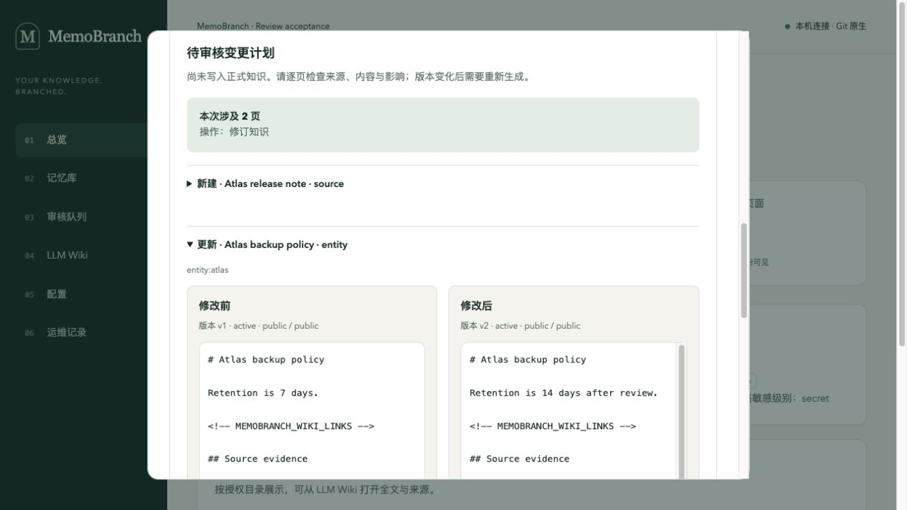
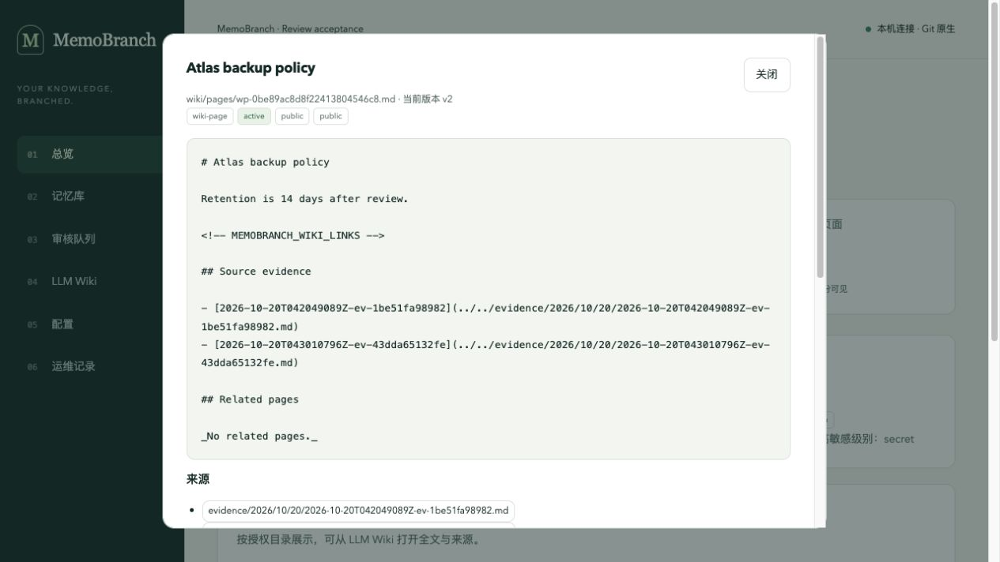

# 第一阶段实现与验收记录

日期：2026-10-20（Asia/Shanghai）。项目：**MemoBranch / sens-io/memobranch**。完整来源分支：`kevin/memory-adoption`。

结论：本次约定的第一阶段已实现，独立审查发现的 5 项确认问题已修复并复审通过；本轮范围内没有已确认但未处理的问题。没有推送、发布 npm 或部署，也没有修改个人客户端配置。

## 本次交付

- 获批普通记忆和有效 Wiki 的完整记录读取，保留来源、修订号、适用条件和不确定性；长度不足时整条省略，不截掉限制条件。
- Claude Code 项目配置的预览、带文件版本检查的应用、备份、真实 MCP 验证和仅移除自有条目；默认只读，不保存密钥。
- DeepSeek Harness 明确开启后，在请求前读取记忆；成功回合可保存证据和未批准候选。默认关闭，失败/中断/超长回合跳过，重试去重，取消和卸载等待工作结束。
- 签名计划的真实新旧内容比较、来源和受影响页面；自然语言纠正先保存证据，再生成独立待审修订。Web 纠正绑定打开页面时的修订号。
- 展示实际检索分数，不把未参与的语义评分当作零分，也不把纯词法检索说成混合检索。
- 37 个公开合成案例、可重跑的离线/明确开启的在线评测、真实用量记录和单独人工评分规则。

使用说明：[记忆读取与审核](memory-adoption.md)、[客户端接入](integrations.md)、[评测限制](../evaluation/README.md)。

## 已执行检查

运行源码候选：`580f71865fc9a3d93831d37bc3fe50865b3552a1`；之后仅补充本记录、任务勾选、生成报告和合成资料截图，不修改运行代码。构建和源码测试使用 Node `22.17.0`。

| 检查 | 实际结果 |
| --- | --- |
| Git 默认分支 `main` 下完整检查 | 构建、类型检查；527 项功能测试 + 14 项发布脚本测试 + 10 项评测测试，全部通过，0 跳过 |
| Git 默认分支 `master` 下完整检查 | 同上，共 551 项，全部通过，0 跳过；与上一轮顺序执行 |
| Node `22.17.0` 实际安装包 | 通过；包含 Web、公开导出和类型、CLI/MCP/Harness 原有 Wiki 流程、新增读取/比较/纠正、客户端配置和真实连通检查 |
| 精确 Node `20.0.0` 实际安装包 | 同一套安装后 JavaScript 验收通过；构建工具使用 Node 22，不以开发加载器冒充最低运行时 |
| 严格 OpenSpec 校验 | 13/13 通过，0 失败 |
| 全部依赖安全检查 | 0 已知漏洞；生产依赖亦为 0。开发测试依赖升级至修复版本，参见 [上游安全公告](https://github.com/advisories/GHSA-6qxp-vccf-f47h) |
| 浏览器实际交互 | 合成资料库登录、打开 v1、保存纠正、比较 v1/v2、独立批准、重新打开 v2、检索分数和原始证据追溯全部完成；浏览器错误日志为空 |
| 最终 37 案例评测 | 111 次测量，运行错误 0、预算跳过 0、模型 HTTP 请求 0；模式和失败案例完整保留 |

本地日志保存在忽略的 `.scratch/`：`final-check-main.log`、`final-check-master.log`、`final-package-node22.log`、`final-package-node20.log`、`final-openspec.log`、`final-audit.json`。没有在文档中保存访问令牌或真实资料。

## 独立审查与修复

三位未参与相应实现的审查者，以固定提交和只读方式审查；未让实现者自行批准。代码审查技能提供文件清单与规则，不依赖另一个收费模型。首轮候选 `b7a90a7`，修复后候选 `580f718`。

| 编号 | 来源分支 | 确认问题 | 修复提交 | 验证与复审 |
| --- | --- | --- | --- | --- |
| R1 | `kevin/memory-adoption` | 新增 MCP 调用未接请求取消信号 | `ad29b0af` | 真实 MCP：取消等待写锁的纠正不保存证据；取消编译关闭本地测试模型连接。复审确认 |
| R2 | `kevin/memory-adoption` | 无关加密证据导致公开记忆读取失败 | `ad29b0af` | 公开普通记忆按命中路径读取；Wiki 在解密前筛选敏感级别；无密钥的普通/Wiki 读取回归通过。复审确认 |
| R3 | `kevin/memory-adoption` | 空语义评分集合仍显示为混合检索 | `ad29b0af` | 按实际评分集合记录策略，区分未评分与计算所得零分。复审确认 |
| R4 | `kevin/memory-adoption` | 客户端配置重新排版后超过自身 1 MiB 读取上限 | `580f7186` | 应用和移除均在替换前检查 UTF-8 字节；覆盖大数组、多字节输入、拒绝后原文件与所有权保留。复审确认 |
| R5 | `kevin/memory-adoption` | 项目内消费者目录触发 TypeScript 6 的 TS5112 | `580f7186` | 加入显式忽略上级配置参数；独立重现通过，Node 22/20.0.0 完整安装验收通过 |

另外加强了旧页面纠正保护和验证子进程清理：过期显示版本在捕获证据前拒绝；验证器返回前等待进程退出，必要时强制终止。相关定向测试和最终完整回归均通过。

### 文件覆盖

初次候选共 37 个变更文件，全部分配审查；修复增加 `src/search.ts`、`src/types.ts`，这两个文件及修改后的相关调用亦已复审。运行实现、测试、包配置、说明和 OpenSpec 的 39 个文件全部审查，跳过 0。

| 审查组 | 分配文件（各行不重复计数） |
| --- | --- |
| 核心与权限，14 个 | `src/{vault,wiki,wiki-types,review-diff,index,mcp,web,search,types}.ts`、`test/review-recall.test.ts`、本变更的 `proposal.md`、`design.md`、`tasks.md`、`specs/memory-adoption/spec.md` |
| 接入与自动操作，10 个 | `src/{deepseek-harness,harness-memory,onboarding,integration-cli,cli}.ts`、`docs/integrations.md`、`test/{deepseek-harness,wiki-adapters,integration-harness-memory,integration-onboarding}.test.ts` |
| 评测与界面，15 个 | `.gitignore`、两个 README、竞品报告、`docs/memory-adoption.md`、`evaluation/{README.md,cases.mjs}`、`scripts/{evaluate-memory.mjs,evaluate-memory.test.mjs,verify-installed-adoption.mjs,verify-package.mjs}`、两个 package 文件、`src/web-ui.ts`、`test/review-ui.test.ts` |

工具默认排除的测试、锁文件和文档也做了人工审查，未把“工具未选择”写成“已审查”。最后增加的验收记录、原样生成报告和截图作为交付证据单独核对，不冒充运行代码审查。

## 评测结果不能当作真实效果

[实际摘要](evaluation/memory-adoption-2026-10-20/report.md)与[原始 JSON](evaluation/memory-adoption-2026-10-20/report.json)原样归档。数据集 `memobranch-synthetic-memory-v1`，37 案例；SHA-256：`a6b488b8a47636041b855ed5985aaa6ed60c4c6a3911d11221db7744f31b724e`。

| 当前代码中的读取策略 | 通过 | 测量失败 | 运行错误 |
| --- | ---: | ---: | ---: |
| 无记忆 `none` | 12 | 25 | 0 |
| 词法 `lexical` | 32 | 5 | 0 |
| Wiki `wiki` | 37 | 0 | 0 |

词法的 5 个失败均为未返回冲突页，因而只能说明证据不足，不能引用并解释相互矛盾的来源；这保留了“冲突不能自动注入为事实”的规则。Wiki 路径能带来源解释冲突。这些是同版实现中的不同读取策略，不是“旧版/增强版”的控制实验，也不是与竞品的比较。

替身读取明确的结构化合成事实。真实模型质量、真实摄取质量、人工语义评分、人工纠正次数、费用改善和统计显著性均未验证。报告诚实记录了生成时有未提交截图，源码散列在运行期间未变化。没有修改报告中的 `dirty:true` 或使用合成结果宣称真实准确率提升。

## 浏览器证据

只使用独立合成资料库；测试服务和临时浏览器标签均已关闭。截图不含令牌。检查的是桌面视图，未声称完成真实手机设备验收。

修改前后比较：

批准后重新读取的 v2，原始来源、适用条件和不确定性保留：

## 提交、配置与发布状态

本轮运行实现按以下提交保存；最终验收资料另作一个提交，之后工作区保持干净：

- `d5e84bf2`：竞品调查和第一阶段优先级。
- `a197cf83`：获批记忆读取、签名计划比较、纠正和界面。
- `baddf3bd`：客户端接入、明确开启的自动操作和评测工具。
- `b7a90a7a`：安装包验收与开发版说明。
- `ad29b0af`：取消、保密读取、真实检索说明和旧显示版本保护。
- `580f7186`：客户端输出大小、验证进程清理和消费者类型检查。

数据库变更：**无**。数据迁移：**无**，资料库格式和正式记录无需迁移。配置变更：增加可选 Harness 自动记忆参数及客户端接入命令，自动操作默认关闭；没有更改本机真实客户端配置，没有写入或迁移密钥。

推送：**未执行**。npm 发布：**未执行**。GitHub 托管 CI、真实模型试用、完整 Harness 界面对话循环和生产部署：**未执行**。若要使用已发布 npm 包之外的新功能，先构建当前分支；后续推送和发布需单独执行。

第一阶段不包含批量资料连接器、PDF 解析、按历史日期查询、多资料库团队协作和自动生成可执行技能；这些仍是后续候选功能，不在本次已完成范围中。
