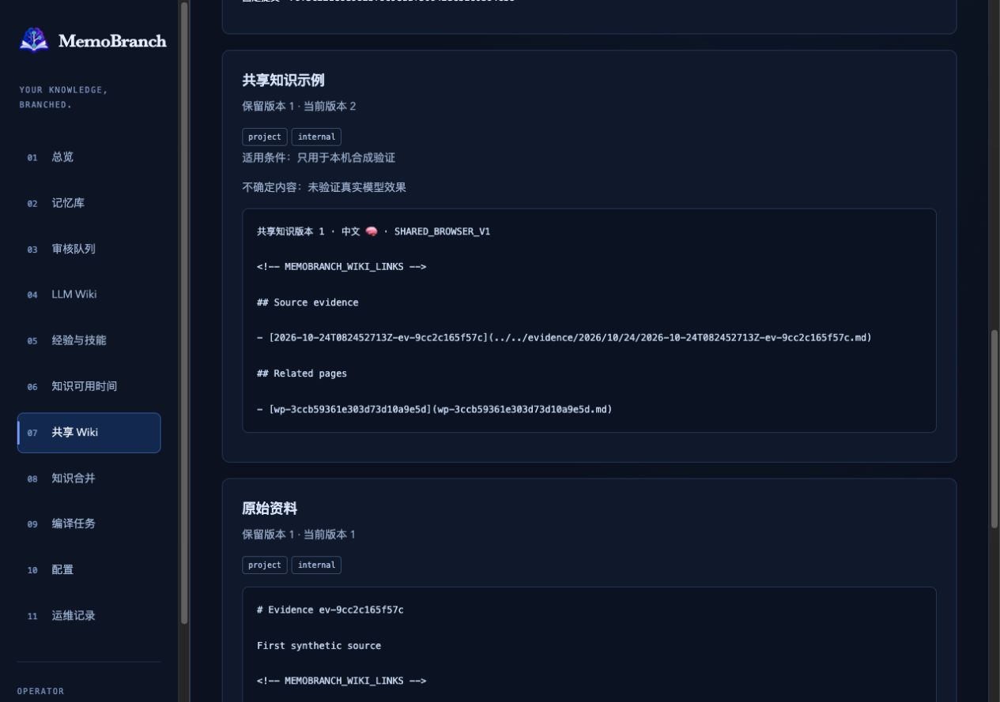
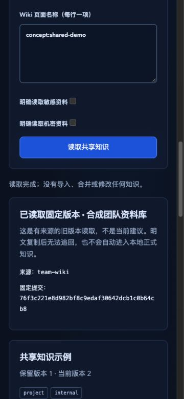

# 固定版本共享 Wiki：本地验收记录

项目 `sens-io/memobranch`，来源分支 `kevin/knowledge-expansion`。
范围为路线图第 3 批：明确宿主配置、读者身份和本机完整提交的只读共享。
用户选择本机／Git 固定版本共享；没有云端账号、真实授权配置、推送或发布。

## 实现与独立审查

| 来源分支 | 固定候选 | 内容 | 独立审查覆盖 |
| --- | --- | --- | --- |
| `kevin/knowledge-expansion` | `60c06b90364ee8fb46fd179a2525495606f5d783` | 初始 OpenSpec 设计 | 4/4 |
| `kevin/knowledge-expansion` | `ac121d37eb9daecce001154b1589a2956ad4ced7` | 最后等待后的到期检查设计 | 3/3 |
| `kevin/knowledge-expansion` | `69992edf49547198a2a96fc408a2f3e08351bd96` | 共享核心、限制与消费者 | 10/10 |
| `kevin/knowledge-expansion` | `1f868afec01ef87339542e1f48e88e68e8132489` | CLI、MCP、Harness | 12/12 |
| `kevin/knowledge-expansion` | `5c29ca6740a89810e88cbdf60c28b307d56cf4af` | 过期列表提交检查 | 12/12 |
| `kevin/knowledge-expansion` | `abd2e6146ac613fea982f59ae5afdb80319ff1c0` | Web 页面、HTTP、消费者与双语说明 | 12/12 |

所有分配文件均已审查，跳过 0。不同候选的计数有重复文件，不能相加当成唯一文件数。
审查者只读固定提交，不代替执行测试。OCR 仅提供本地文件选择／规则解析，未调用远程
模型；范围 `60c06b9..abd2e61` 的 27 个文件中，OCR 默认选 12 个，排除 15 个测试／
文档等文件；排除文件仍通过上述独立分配覆盖。Git 2.39.3 的旧版本提示保留，未升级。

| 来源分支 | 已解决事项 | 处理与证据 |
| --- | --- | --- |
| `kevin/knowledge-expansion` | 设计审查要求：来源读取完成后，再等待调用方锁可能跨过到期时间 | 设计 `ac121d3` 明确最后同步检查，核心 `69992ed` 保留检查函数；真实锁等待分别跨过当前／旧页到期及事实有效期时均拒绝正文 |
| `kevin/knowledge-expansion` | 实现时发现：列表显示版本 A 后，宿主可能改为版本 B | `5c29ca6` 增加 `expectedCommit`，访问来源前拒绝过期选择；网页固定发送显示值，不能改选提交 |
| `kevin/knowledge-expansion` | 验收文字把安装消费者检查范围写得过宽 | 收窄为双方 HEAD、来源索引及来源原始证据；双方完整状态由核心／HTTP／浏览器检查证明，不冒充安装脚本检查 |

上述问题均已处理并复查。本批范围内没有已确认且未解决的问题；不承诺不存在未知缺陷。

## 自动验证

| 检查 | 实际结果 | 本机日志 |
| --- | --- | --- |
| 核心及已有快照／可用时间检查 | 初版 57 项通过；包含真实双向并发、取消、文件替换、密钥和最后等待到期 | `.scratch/shared-wiki-core-targeted-3.log` |
| CLI／真实 SDK 与版本前置条件 | 45/45，无失败／取消／跳过 | `.scratch/shared-wiki-pin-precondition-targeted.log` |
| HTTP／UI 与已有 Web 检查 | 104/104，无失败／取消／跳过 | `.scratch/shared-wiki-web-targeted-1.log` |
| 完整保留检查，Git 默认 `main` | 856 功能 + 14 发布脚本 + 10 评估 = 880，通过 | `.scratch/shared-wiki-full-main.log` |
| 完整保留检查，Git 默认 `master` | 同样 880，通过 | `.scratch/shared-wiki-full-master.log` |
| 严格 OpenSpec | 29/29 | `.scratch/shared-wiki-web-specs.log` |
| 生产依赖审计 | 0 漏洞 | `.scratch/shared-wiki-audit.json` |
| 同一压缩包，Node 22.17.0／`main` | 真实独立安装、类型及 API／CLI／MCP／Harness／HTTP 全部通过 | `.scratch/shared-wiki-package-node22.log` |
| 同一压缩包，Node 20.0.0／`master` | 同样通过；保留 npm 11 自身的 Node 版本支持警告，实际消费者使用 Node 20.0.0 | `.scratch/shared-wiki-package-node20.log` |

压缩包为 `.scratch/shared-wiki-package.BeISu0/memobranch-1.1.0.tgz`，401 项。
SHA-256 为 `f71ae58885aa6b3c8c8fa82a520f5aca12c0ba501ecd5232608584a5a9fe5e90`。
两次安装使用同一个文件，前后哈希一致，比较退出 0。内容包含 `abd2e61` 运行时代码
以及本记录随后保存的两张实际截图；本记录及之后的验收文字不在该压缩包中。
这些是本地打包／安装检查，版本号未增加，也未发布 npm。

安装消费者创建两个真实合成 Git 资料库，来源更新后仍读旧固定提交，检查来源身份、
更改授权、当前撤回、预先取消、双方 HEAD、来源索引及来源原始证据不变，且无额外模型调用。
双方完整状态另外由核心／HTTP／浏览器检查证明，未声称安装脚本检查了调用方索引／证据。
HTTP 中途取消另由真实锁等待测试证明；安装脚本的预先取消不能替代该测试。

## 实际浏览器检查

临时合成目录 `.scratch/web-shared-browser-Lw0Ueq`，本机网页已停止，标签页已关闭，
宽度覆盖已重置。运行的是 `abd2e61` 构建的网页；共享页面编译文件 SHA-256：
`6367747caf3b8daef9628014cb3f260218df7837ccec03877f4b0435fab6ca14`。
观察记录 `.scratch/shared-wiki-native-observations.json`，前后状态 `.scratch/web-shared-browser-after.json`。

- 只读合成身份进入共享页面仅加载目录，快照调用数为 0；私密选项默认关闭且在 internal 上限下禁用。
- 明确读取 `concept:shared-demo`：固定提交 `76f3c221e8d982bf8c9edaf30642dcb1c0b64cb8`，
  来源当前提交 `409cd8c6630c61fc6be59f06a919d9c6a72286bd`。显示完整第一版正文、
  “保留版本 1／当前版本 2”、适用条件、不确定内容及来源摘要页，未显示第二版正文。
- 展开完整 JSON，看到原始来源 ID／完整内容哈希、规则 ID／修订及来源身份；没有把原始资料正文或密钥作为附件导出。
- 显示目录后把合成宿主固定提交改为新版：旧请求返回 `VALIDATION_FAILED`，旧正文清除，不回退或自动重试。
- 把读者改为另一个合成身份：列表无来源、读取按钮禁用、正文为空。
- 真实持有来源锁时开始读取：队列 2 项；点击停止后队列降为 1 项，只剩测试持有者。
  输入保留，正文为空，没有重试。随后释放持有者，其进程正常退出。
- 修改字段、离开页面、返回及断开登录分别检查：旧正文为空；返回时输入为空；注销后访问令牌输入为空。
- 桌面设置 1280×900，文档宽／滚动宽均 1265；手机设置 375×812，两者均 360。
  页面无横向溢出。实际 JPEG 尺寸分别为 1265×889、360×780，不冒充设置尺寸。

合成夹具首次遗漏导航响应，被正常校验拒绝后修正；一次用空读者数组模拟撤权，被严格
配置校验拒绝，随后改为合法的其他读者配置。另一次观察脚本使用不存在的 DOM ID，
修正后记录实际选择框。上述失败没有计为通过，未修改产品检查或测试断言。

正常停止时检查来源和调用方的 HEAD、refs、索引哈希、原始证据哈希及模型调用数与
读取前完全相同（夹具构建调用 3 次，交互后仍为 3 次）；总共享快照调用 6 次，含拒绝和取消。

## 使用和交付边界

共享配置最多 100,000 UTF-8 字节、20 个来源、每来源 100 个身份／所属库组合。
库完整结果上限 20 MB，MCP／Harness 转义结果 9 MiB，HTTP 完整结果 16 MiB。
调用方和来源锁不同时持有；来源身份、当前权限、密钥、撤回、到期、干净状态及完整本地
祖先提交仍须通过。宿主路径／密钥／身份不能由请求覆盖；来源不会自动 fetch。

本地克隆不能凭空知道远端撤回，已复制明文不能追回。这不是跨库导入、Git 分支合并、
云端共享或真实模型质量验收。第 4–6 批仍待完成。

数据库变更：无。数据迁移：无。可选配置变更：`AMEM_SHARED_WIKI_CONFIG`、
宿主共享 JSON、可选来源密钥环境变量名及 Harness／Web 的 `sharedWikiConfig`。
开发仅配置合成资料库，未对真实资料库执行这些配置；未推送、发布、部署或安装技能。
