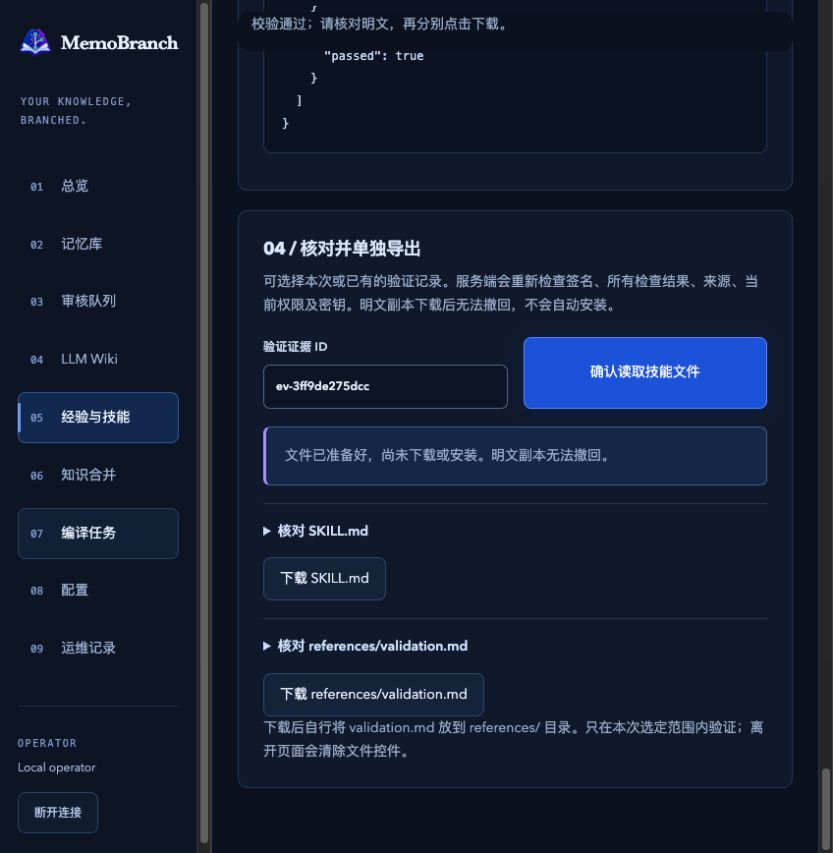
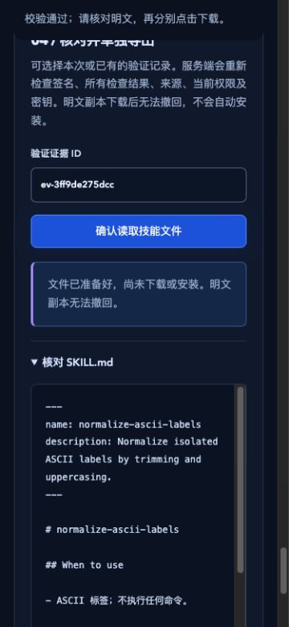

# Experience Web management — work record, 2026-10-23

Repository: `sens-io/memobranch`. Source branch: `kevin/knowledge-expansion`.
Baseline: `6b9223bb3fab1c2fc3ed86f4aca9aafa85a81865`.
Runtime candidate: `d329b3c1887d542d4a0da43e374aae8b2a15987e`.
Runtime, retained, installed and fixed-commit review checks passed. Native-browser
checks were subsequently completed on **2026-10-24** as recorded below. Combined
retained/installed checks after the later Zod security update remain pending;
this batch is not closed solely by the browser result.
The overall roadmap remains open.

The local page separates immutable observations, expiring signed procedure
proposals, trusted-host checks and confirmed plaintext export. The default host
has no evaluator. Optional `WebOptions.experienceRunner` is trusted application
code, never an HTTP executable path, uploaded script or vault setting. Core
coverage, deadlines, current source/tenant/classification and key checks apply.
Listing searches raw markers, not verified passing status. Unselected private
records are filtered before decryption; selected broken keys cause a visible error.

The page owns its request signals, rejects stale results and removes old file
controls after edits or leaving. Page-contained confirmation dialogs default to
cancel; leaving an unconfirmed dialog starts no validation. Downloads require
separate clicks. No skill is installed or executed. Offline plaintext cannot
be recalled, and stopping a save cannot undo an already completed transaction.

## Checks recorded so far

| Check | State / evidence |
| --- | --- |
| Build and test types | Passed before candidate commit |
| Related HTTP, real UI-handler and retained Web checks | 83/83, failure/cancellation/skip 0; `.scratch/web-experience-targeted-3.log` |
| Full Node 22 / Git main | 789 functional + 14 release + 10 evaluation = 813 passed, failure/cancellation/skip 0; `.scratch/web-experience-full-main.log` |
| Full Node 22 / Git master | Same 813 passed, failure/cancellation/skip 0; `.scratch/web-experience-full-master.log` |
| Strict OpenSpec 1.0.2 | 27 passed, 0 failed; `.scratch/web-experience-specs.log` |
| Production audit | 0 known production vulnerabilities; `.scratch/web-experience-audit.json` |
| Same installed artifact on Node 22.17.0 / Git main | Passed, 368 packed entries; `.scratch/web-experience-package-node22.log` |
| Same installed artifact on exact minimum Node 20.0.0 / Git master | Passed, same 368-entry tar; `.scratch/web-experience-package-node20.log`; before/after SHA-256 files compare equal |
| Fixed-commit independent review | All 15 files reviewed, skipped 0, no confirmed open issue; includes eight excluded by OCR defaults |
| Native-browser workflow and responsive verification | Completed on 2026-10-24 in a fresh synthetic vault; see supplemental evidence below |

The backend tests use real local HTTP, vault transactions and encryption with
synthetic data. They cover absent evaluators, strict unknown-field rejection,
explicit confirmation, current operation/tenant authority, opted-out
private decrypt count, erased keys, failed/forged reports, cancellation/shutdown
and safe completed-record metadata. A read-cleanup authority change cannot expose
old counts even when the requested offset has no visible rows. UI-handler tests
exercise separate confirmations, cancellation, edits, late responses, read-only
controls, explicit downloads and closing an unconfirmed dialog on navigation.
Their DOM substitute is not a native accessibility or browser rendering test.

Initial strict optional-property/type-narrowing authoring errors were corrected
before these results. Earlier 81/81 passes preceded the final two regressions;
they are not substituted for 83/83 acceptance. Existing assertions, concurrency
and time limits were not reduced. OCR provides local file selection/rules only;
the older Git warning is retained and no external review endpoint is used.

Installed artifact: `.scratch/web-experience-package.viqTYw/memobranch-1.1.0.tgz`.
Its SHA-256 is `c50fb1a6c4691b5cea05dd1d56a92c22d56f73c54dc17ef7902c9fdb70ab8df2`,
recorded in `.scratch/web-experience-package-before.sha256` and the equal
`-after.sha256` file. It contains runtime candidate `d329b3c` and the
earlier, honestly pending version of this work record/roadmap. Later verification
text is not in that artifact and does not change its runtime. No publication is implied.

The two independent reviewers covered 5 backend/test/installed-consumer files and
10 UI/type-consumer/document/spec files. Backend in-memory request replays covered
host-runner override refusal, safe error fields, simultaneous cancellation isolation,
default private opt-out and stopping. UI replays covered stopped old responses
arriving after new results, edited checks invalidating downloads, cancelled dialogs,
disconnect and separately confirmed retries. The latter used Node 26.8.2 with a
small DOM; both reviewers used substitutes, not independent real browser, TCP,
encryption or package installations. Those limits do not replace the executing
retained/HTTP/installed checks above.

## Earlier browser limitation

An earlier, uncommitted UI build in the in-app browser successfully generated a
real signed proposal against a synthetic vault. Its native JavaScript confirmation
then stopped responding through the browser-control API. Attempts to inspect,
accept and close that temporary target timed out; they are not validation passes.
The actual submitted validation was not observed completing. No screenshot was
obtained from that blocked target.

The new candidate uses accessible page-contained `dialog.showModal()` confirmations
instead. Its cancellation/navigation checks passed. A fresh synthetic page rendered,
but interaction remained blocked by the old browser confirmation; the operator was
asked asynchronously to close it. At that checkpoint the native workflow,
mobile layout and browser downloads remained unverified; the later actual checks
are recorded below.
These tests never target the operator's real vault or modify its grants.

## Supplemental native-browser evidence — 2026-10-24

The old temporary browser targets and test process were confirmed gone, so a fresh
synthetic vault was started on local Node 22.17.0. The served script's SHA-256 is
`3fa4bc0d095a6c3de3775cd15e6dd2e2c375032a7bb4d06b60488806aedd7ef9`.
It equals the current compiled asset; `src/web.ts`, `src/web-ui.ts` and
`src/web-experience-ui.ts` are unchanged from `d329b3c`. The host process began before
the later local Zod update; patched-dependency retained/installed checks are separate.

Actual browser actions confirmed capture (`ev-79180fdd4e1b`), signed proposal,
four host-evaluated synthetic checks, independently cancelled/confirmed export,
both explicit file downloads, editing invalidation and disconnect back to login.
Validation evidence: `ev-3ff9de275dcc`. The host actually trimmed/uppercased selected
ASCII inputs against independent expected labels and required the named criterion;
this is not a universal evaluator or real task-effectiveness claim. Capture retained
the form contents. No canonical memory/candidate, installation or execution occurred.

The actual browser downloads were compared byte-for-byte with a fresh authorized
library export: `SKILL.md` 708 bytes, SHA-256
`402fbe006f768f776c4e067537940c29dc2142928728b02a2373bfa237af0cf2`;
`references/validation.md` 979 bytes, SHA-256
`04e23dd27960ab971b67dc090ee073daadf62c566e988e12a68b9decc3b1068c`.
The verification itself left HEAD unchanged. The browser saved synthetic files in
its ordinary Downloads folder; no preexisting files were removed. Evidence log:
`.scratch/web-experience-browser-verification-2026-10-24.log`.

At the default 833×868 content viewport, document client/scroll widths were both
833. With the browser set to 375×812, client/scroll widths were both 360 (the
remaining width is its scrollbar), no document-wide horizontal overflow. The
small-screen preview and controls were usable; editing cleared the validation ID,
disabled old validation/export and left zero skill-download controls. The viewport
override was reset, console errors were empty, and the temporary tab was closed.

## Changes and remaining work

Push/publication/deployment: none. Database change: none. Data migration: none.
Required or persisted configuration change: none. Optional host API: the trusted
evaluator callback above; default behavior remains no evaluator. No real service
configuration or permission was changed. The Web implementation itself did not
change manifests/lockfile; the later dependency security update is tracked separately.

`frontend-design` informed reuse of the existing dark workbench, logo-derived
cobalt/violet/teal palette, offline fonts, readable form stages and explicit state
controls. No remote font, CDN, generic redesign or new frontend dependency was added.

Complete combined patched-dependency checks and review the final checkpoint text;
fix and recheck any confirmed finding. Record browser results honestly. Do not close batch 1
or the overall goal at this intermediate checkpoint. Time availability, pinned
local/Git sharing, cross-vault import/merge and local OCR remain in
[remaining work](remaining-roadmap.md).
